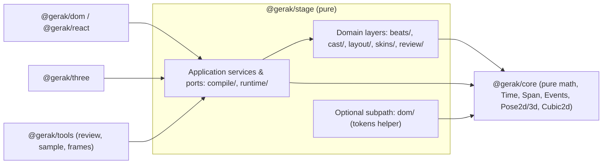

# Greenfield Redesign Plan: `@gerak/stage`

## Goal

Piece authors (humans and AI coding agents) use `@gerak/stage` to declare a complete, deterministic motion piece in a single typed `defineStage` definition, while renderers (`@gerak/dom`, `@gerak/three`, future `canvas` / `svg`) and headless tools (`@gerak/tools`) execute and audit that piece through one validated runtime contract (`CompiledStage`).

This plan starts from zero backwards-compatibility constraints and enforces **Clean Architecture**, **KISS**, **DRY**, **SOLID**, and **exhaustive discriminated unions** across code, runtime validation, and documentation — delivered via **one branch, four sequential commits, one cold review, and one PR**.

---

## 1. Architectural Boundaries & Dependency Rule

`@gerak/stage` remains strictly **pure** (`layer: "pure"`): zero DOM APIs, zero `node:fs` / `fetch`, zero timers, and zero global mutable state. Its only package dependency is `@gerak/core`.

To satisfy **both** Clean Architecture's inward dependency rule and `scripts/reference.mjs`'s folder-per-reference-group documentation generator (just like `packages/core/src/*`), top-level folders are organized as layered domain capabilities whose internal imports form an acyclic inward DAG:



### Module Structure

```text
packages/stage/src/
  beats/      # Pure timeline model: Story / CompiledBeats wrapping @gerak/core Span + durationMs
  cast/       # Closed unions (ActorContent, Member, ListActor) + visibility, morph, stroke passes
  layout/     # Box, RestReader, LayoutSpec ("single" | "multi"), internal box-carry solver -> Pose2d
  skins/      # Open RendererSkins<K> registry + DomSkinCss ("url" | "inline")
  review/     # MotionExpectation ("settle" | "ambient" | "static"), CompiledReviewSpec
  compile/    # Single validator/normalizer (compileStage) -> CompileResult<CompiledStage, StageError[]>
  runtime/    # Authoring port (defineStage), single-owner shape checks, evaluateFrame(...)
  dom/        # Optional subpath ("@gerak/stage/dom"): CSS custom-property token utilities
  index.ts    # Re-exports public stage API (beats, cast, layout, skins, review, compile, runtime)
```

### SOLID Check
- **Single Responsibility:** Timeline (`beats`), cast declarations (`cast`), layout & carrying (`layout`), renderer skins (`skins`), review policies (`review`), compilation (`compile`), and frame evaluation/shape validation (`runtime`) each have one owner. CSS token helpers move out of the main entry into `dom/`.
- **Open/Closed:** Renderers register skins via module augmentation on `RendererSkins<K>` without modifying `@gerak/stage`.
- **Liskov Substitution:** Single-layout, multi-layout, and headless (`NO_REST`) runs share one `RestReader` (`get(name)` safely returns a zero `Box` when unmeasured).
- **Interface Segregation:** Authors touch `defineStage`; renderers read `stage.members` + `evaluateFrame` (no review lint flags); `@gerak/tools` reads `stage.review` without DOM or renderer knowledge.
- **Dependency Inversion:** Domain and services depend only on `@gerak/core`; browser CSS loading (`<link>`), Node CSS reading (`node:fs`), WebGL meshes, and Canvas drawing stay strictly in outer adapters.

---

## 2. Domain Model: Discriminated Unions (No Illegal States)

### A. Actor Content (`ActorContent`)
Replaces optional overlapping fields (`text?`, `path?`, `shapes?`) with an explicit closed union:

```ts
export type ActorContent =
  | { readonly kind: "empty" }
  | { readonly kind: "text"; readonly value: string }
  | { readonly kind: "readout"; readonly format: (time: Time) => string }
  | { readonly kind: "stroke"; readonly path: ActorPath }
  | {
      readonly kind: "morph";
      readonly base: readonly Cubic2d[];
      readonly targets: readonly (readonly Cubic2d[])[];
    };
```

- Dynamic layout-reading paths (`(rest: RestReader) => Cubic2d[]`) are allowed only on `"stroke"`.
- `"morph"` requires fixed outlines up front and pre-matches them during `compileStage`.

### B. Members (`Member` & `ListActor`)
Bans dynamic time readouts inside lists (`many`, `letters`, `words`) at compile time rather than failing at runtime:

```ts
export type ListActor<B extends string, K extends string> = {
  readonly kind: "actor";
  readonly content: Exclude<ActorContent, { readonly kind: "readout" }>;
  readonly meta: MemberMeta<B>;
};

export type Member<B extends string = string, K extends string = string> =
  | { readonly kind: "actor"; readonly content: ActorContent; readonly meta: MemberMeta<B> }
  | { readonly kind: "list"; readonly items: readonly ListActor<B, K>[]; readonly meta: MemberMeta<B> }
  | { readonly kind: "group"; readonly members: Readonly<Record<string, Member<B, K>>>; readonly meta: MemberMeta<B> };
```

### C. Review Expectations (`MotionExpectation`)
Replaces overlapping `still?: boolean` and `ongoing?: boolean` booleans (where `{ still: true, ongoing: true }` was nonsensical) with one closed union (default `"settle"`):

```ts
export type MotionExpectation =
  | "settle"   // default: must move (unless watch: true) and hold steady >= holdMs at end
  | "ambient"  // continuous loop (snow, spinner); must move (unless watch: true), no end-hold required
  | "static";  // scenery / SVG prop; must stay unmoved across the entire piece
```

Inheritance rules resolved once by `compileStage` into `stage.review`:
- `"ambient"` propagates down from `group` / `list` to children/items unless overridden.
- `"static"` on a `group` locks only the group container itself; children keep their own expectation (while `.static()` on a `list` marks the list items static).
- An actor that rests during Beat 1 and animates during Beat 2 uses `"settle"` (the default), **not** `"static"`.
- `"static"` members are disallowed (`never`) in `scene`'s return type; non-static members remain optional (`?`) in `scene` so authors can animate piece by piece without TS errors mid-edit, while `gerak review` enforces `"settle"` vs `"ambient"`.

### D. Layouts (`LayoutSpec`)
```ts
export type LayoutSpec<L extends string = string> =
  | { readonly kind: "single"; readonly rest?: Rest }
  | {
      readonly kind: "multi";
      readonly names: readonly [L, ...L[]];
      readonly pick: (events: Events) => L;
      readonly rests?: Readonly<Record<L, Rest>>;
    };
```

### E. Pose Parameterization (`PoseMode`: `"2d" | "3d"`)
`defineStage` and `CompiledStage` parameterize the stage pose type over `P extends "2d" | "3d" = "2d"` (`PoseFor<"2d"> = Pose2d`, `PoseFor<"3d"> = Pose3d`):
- Default pieces write `Pose2d` with zero extra type arguments.
- Setting `pose: "3d"` lets `@gerak/three` stages reuse `beats`, `cast`, `review`, `skins`, and `evaluateFrame` with `Pose3d` targets.

### F. Structured Errors (`StageError` & `CompileResult`)
```ts
export type StageError =
  | { readonly kind: "duplicate_member"; readonly name: string }
  | { readonly kind: "reserved_dot_in_name"; readonly name: string }
  | { readonly kind: "empty_on_stretches"; readonly member: string }
  | { readonly kind: "unknown_beat"; readonly member: string; readonly beat: string }
  | { readonly kind: "reversed_stretch"; readonly member: string; readonly from: string; readonly to: string }
  | { readonly kind: "morph_mismatch"; readonly member: string; readonly reason: string }
  | { readonly kind: "stroke_loop"; readonly loop: readonly string[]; readonly behind: readonly string[] }
  | { readonly kind: "invalid_initial_layout"; readonly message: string }
  | { readonly kind: "empty_layouts" }
  | { readonly kind: "shape_mismatch"; readonly member: string; readonly reason: string };

export type CompileResult<S> =
  | { readonly ok: true; readonly stage: S }
  | { readonly ok: false; readonly errors: readonly StageError[] };
```

---

## 3. Authoring Experience (`defineStage`) — DRY & KISS

A single typed factory connects **Beats -> Cast -> Layouts -> Skins -> Scene** so names are declared **once**:

```ts
import { ease, mix } from "@gerak/core";
import { defineStage } from "@gerak/stage";

export default defineStage({
  pose: "2d",

  beats: {
    enter: [0, 500],
    hold: [500, 1600],
  },

  cast: (m) => ({
    caption: m.text("Click card for detail").static(),
    snow: m.many(20).ambient(),
    card: m.group({
      badge: m.text("READY").on("enter", ["enter", "hold"]).watch(),
      letters: m.letters("HELLO"),
    }),
  }),

  layouts: {
    names: ["list", "detail"] as const,
    pick: (events) =>
      events.findLast((e) => e.name === "click")?.target === "badge" ? "detail" : "list",
  },

  skins: {
    dom: {
      css: new URL("./badge.css", import.meta.url),
    },
  },

  scene: ({ time, beats, carry }) => {
    const t = beats.enter.of(time, ease.cubicOut).progress;
    return {
      card: carry("card", { ms: 450, ease: ease.cubicOut }),
      badge: { scale: mix(0.85, 1, t) },
      letters: Array.from({ length: 5 }, () => ({ opacity: t })),
      snow: Array.from({ length: 20 }, (_, i) => ({ y: (time.progress * 300 + i * 25) % 720 })),
    };
  },
});
```

### Compile-Time & Runtime Shape Rules
- **`list` returns stay `readonly P[]` in TypeScript:** forbids single `Pose` objects while keeping `.map(...)` and `Array.from(...)` clean.
- **Single-owner runtime & review shape checking inside `@gerak/stage`:** `evaluateFrame` / `validateSceneOutput` checks an exhaustive `switch (member.kind)`:
  - `"actor"` / `"group"` → fail with `shape_mismatch` if `Array.isArray(value)`.
  - `"list"` → fail with `shape_mismatch` if `!Array.isArray(value)` or `value.length !== member.items.length`.
  Renderers and headless `gerak review` call this one check.

---

## 4. Transitions Strategy (Agent Clarity First)

Do **not** expose an abstract `transition<T>({ at, mix })` function in `@gerak/core`. Keep one concrete API per intent:

| Transition intent | API | Output | Owner |
| --- | --- | --- | --- |
| Beat / timeline interpolation | `mix(a, b, beats.enter.of(time, ease.cubicOut).progress)` | `number` / `Pose` | `@gerak/core` |
| Layout / shared-element carry | `carry("card", { ms: 450, ease, mode? })` | `Pose2d` | `@gerak/stage` |
| Vector outline morph | `{ shape: progress }` on `m.morph(base, targets)` | `number` | `@gerak/stage` |
| Interactive event spring *(optional)* | `follow(...)` / `react(...)` | `number` | `@gerak/moves` |

Inside `@gerak/stage/src/layout/`, the mid-flight interruption solver stays private and feeds an exhaustive `switch (mode)` over `"scale" | "clip" | "keep"`.

---

## 5. External Skins & Multi-Renderer Port

1. **Open `RendererSkins<K>` interface:**
   `@gerak/stage` exports `export interface RendererSkins<K extends string> {}` with zero DOM/Three/Canvas types. Renderer packages augment it via declaration merging, keyed against the piece's cast key union `K`.
2. **External `.css` `URL` + inline test escape hatch for `dom` skin:**
   ```ts
   export type DomSkinCss =
     | { readonly kind: "url"; readonly css: URL; readonly defs?: URL }
     | { readonly kind: "inline"; readonly css: string; readonly defs?: string };
   ```
   Authors pass `css: new URL("./badge.css", import.meta.url)` (`"url"`) or `css: "..."` in headless tests (`"inline"`):
   - **Browser (`@gerak/dom`):** `"url"` attaches `<link rel="stylesheet" href={css.href}>` in Shadow DOM and triggers/awaits re-measurement on load; `"inline"` injects `<style>` synchronously.
   - **Node (`@gerak/tools`):** `"url"` reads `fs.readFileSync(source.css, "utf8")`; `"inline"` validates `source.css` directly.

---

## 6. Runtime Execution & Review Pipeline

Every consumer calls the same pure entry points:

1. **`compileStage(definition)`** — validates uniqueness, non-empty layouts, `pick([])`, beat stretches, morph outlines, and produces `CompiledStage` (`members` separate from `review`).
2. **`resolveStaticStrokes(stage, rest)`** — resolves dependency passes and returns `Cubic2d[]` or a typed `stroke_loop` error.
3. **`evaluateFrame(stage, { time, events, boxes })`** — runs single-owner shape validation (`Array.isArray` & list length) and returns active layout, visibility, `scene` poses, dynamic `readout` strings, and blended morph `Cubic2d[]`.
4. **Reviewer (`@gerak/tools`):** inspects `CompiledStage.review` using one exhaustive `switch (expectation)` over `"static" | "settle" | "ambient"`, honoring `watch` exemptions, `on`-stretch windows, and `evaluateFrame` shape checks.

---

## 7. Documentation Architecture (Clean Trimmed Rewrite in `@gerak/core` Style)

Because this is a major refactor of the stage API, rewrite **all** `@gerak/stage` docs cleanly in the dense, low-token pattern of `packages/core/docs/core.md` and `packages/core/docs/reference/`:

1. **`packages/stage/docs/stage.md` (clean trimmed rewrite, ~75–90 lines):**
   - **Header:** `# @gerak/stage`, read-whole note, canonical import (`import { defineStage } from "@gerak/stage"`).
   - **`## How stage works`:** 1 ASCII dataflow diagram (`defineStage -> compileStage -> measure Rest -> evaluateFrame(time, events, rest) -> Renderer`), Shadow DOM rules (`:host`, `[data-cast]`, `[data-layout]`), 2D vs 3D (`pose: "3d"`), and zero-box headless fallback.
   - **`## Beats, cast, and expectations`:** compact tables covering `beats`, cast builders (`box`, `text`, `readout`, `stroke`, `morph`, `many`, `letters`, `words`, `group`), modifiers (`.on()`, `.watch()`, `.pivot()`, `.static()`, `.ambient()`).
   - **`## Layouts, carry, and skins`:** compact rules for `single` vs `multi` `layouts`, `carry("card", { ms, ease, mode? })`, external `new URL("./piece.css", import.meta.url)` vs inline test CSS, open `RendererSkins<K>`.
   - **`## Review loop and traps`:** tight checklist (`"settle" | "ambient" | "static"`, `gerak review` headless + `sheet.png` eye check, O(1) history-free scenes, `Array.isArray`/length rules, CSS/contrast pitfalls).
   - **`## Idiom`:** one canonical ~15-line `defineStage` snippet.
   - **`## Exports by reference group`:** `<!-- generated:reference:start --> ... <!-- generated:reference:end -->` names-only index linking to `reference/<group>.md`.
2. **Grouped Reference Docs (`packages/stage/docs/reference/`) & `scripts/reference.mjs`:**
   - Replace flat `packages/stage/docs/reference/index.md` with per-folder group pages:
     `beats.md`, `cast.md`, `layout.md`, `skins.md`, `review.md`, `compile.md`, `runtime.md`, plus `dom.md` (`@gerak/stage/dom`).
   - Add `STAGE_INTROS` alongside `CORE_INTROS` in `scripts/reference.mjs` for ordered learning summaries in `packages/stage/docs/reference/README.md`.
3. **Clean trimmed rewrites of ALL `@gerak/stage` sub-guides & nav:**
   - **`packages/stage/docs/README.md`:** keep slim navigation table aligned with trimmed sub-guides.
   - **`packages/stage/docs/agent-layout.md` (~35–45 lines):** rewritten from scratch for `layouts: { names, pick, rests? }` + `carry("card", { ms, ease })`, external CSS `[data-layout="..."]`, routes, and list-slot reordering.
   - **`packages/stage/docs/agent-events.md` (~35–45 lines):** rewritten cleanly around `defineStage({ cast, cues, scene })`, `.watch()`, pointer coords, `@gerak/core` `tally`/event folds, optional `@gerak/moves` `follow`/`react`, and `--action`/`--events` CLI usage (stripping obsolete `eventDriver` / standalone `export const cues` snippets).
   - **`packages/stage/docs/agent-inputs.md` (~25–35 lines):** rewritten cleanly around `cues` JSON import in `defineStage`, `m.morph(...)` (linking morph outline rules to `stage.md` / `reference/cast.md` without duplicating), `mountStage.send`, and `tally`.
4. **Sibling repo doc grep (before cold review):**
   - Search sibling docs (`docs/ARCHITECTURE.md`, `docs/guide/`, `packages/moves/docs/agent-reel.md`, `packages/dom/docs/agent-outside.md`, `packages/tools/docs/`) for stale `readStageModule`, `story(`, `actor(`, `carried({`, `export const cast` stage snippets and align them in Commit 4.

---

## 8. Wave Execution Plan (`.claude/skills/wave-build`: 4 Commits, 1 PR)

Follows `.claude/skills/wave-build` workflow while avoiding redundant slow full-suite runs on intermediate steps (the browser test suite takes ~100s+ and is prone to full-load browser timeouts per `wave-build/references/lessons.md`):

### Pre-Wave Setup (New Session Lead — Hydrogen Extra)
1. Inspect `AGENTS.md`, `docs/SESSION-STATUS.md`, `.claude/skills/wave-build/SKILL.md`, and current `packages/stage/src/*`, `packages/dom/src/stage.ts`, `packages/tools/src/scene/{scene,review,piece-edit}.ts`, and `scripts/reference.mjs` for exact workspace contracts.
2. Branch directly off `refactor/points-and-reference` (`cece342e`): `git checkout -b feat/stage-greenfield refactor/points-and-reference`, and confirm `git ls-files --eol` shows `i/lf`.
3. Push the starting branch commit so parallel Wave 1 builders share one exact pushed base SHA.

### Commit 1 (Lead — Hydrogen Extra): `@gerak/stage` greenfield core + unit tests
- **Why Lead builds Commit 1:** `@gerak/stage` defines every shared type, error union, and contract consumed by all downstream waves (`wave-build`: *"Build anything that decides later slices' shape yourself, first"*).
- **Owns:** `packages/stage/src/**`, `packages/stage/package.json`, `packages/stage/test/**`.
- **Verification (fast only):**
  - `npx vitest run packages/stage/test`
  - `npx tsc -p packages/stage/tsconfig.build.json --noEmit`
  - `npm run scan:cycles` and `npm run scan:boundaries`
  *(Skip full workspace `npm run check` here since downstream callers migrate in Commits 2–3.)*
- Commit (`feat(stage): redesign greenfield stage contract, compiler, and evaluator`) and **push branch** so Wave 1 builders fetch the exact Commit 1 SHA.

### Wave 1 — Two Parallel Builders (`Hydrogen High`, isolated worktrees)

Both builders run in parallel from Commit 1's pushed SHA (`swarm` / `models` pinned to Hydrogen High if listed, else `inherit`) with **strictly disjoint file ownership** and **fast targeted verification only**:

- **Builder A → Commit 2 (`feat(dom,react): migrate stage mounting and skins to CompiledStage`):**
  - **Owns:** `packages/dom/**`, `packages/react/**`.
  - **Changes:** Adapt `mountStage` and `<Stage />` to `CompiledStage` + `evaluateFrame`; support `DomSkinCss` `"url"` (`<link rel="stylesheet">` inside Shadow DOM + load re-measure + `ready` signal) and `"inline"` (`<style>`); adapt tests in `packages/dom/test/**` and `packages/react/test/**`.
  - **Fast check (save output to log, test exit code, delete `packages/*/dist` before checking):**
    - `npx vitest run packages/dom/test packages/react/test`
    - `npx tsc -p packages/dom/tsconfig.build.json --noEmit` and `npx tsc -p packages/react/tsconfig.build.json --noEmit`
    - Never run full workspace `npm test`; report `"not verified"` list cleanly.

- **Builder B → Commit 3 (`feat(tools,pieces): migrate cli tools, review rules, scaffold, and pieces to defineStage`):**
  - **Owns:** `packages/tools/**`, `apps/pieces/**` (excluding anything inside `packages/dom`, `packages/react`, `packages/stage`, `scripts/`).
  - **Changes:** Update `readSceneModule`, `review.ts` (wire `MotionExpectation` `"static" | "settle" | "ambient"`, `evaluateFrame` `shape_mismatch` errors, `"url"` `.css` reading via `node:fs`), `scaffold` / `stage.ts.template`, `piece-edit.ts` (update AST edits inside `defineStage({ ... })`), and migrate `apps/pieces/*` & `packages/tools/test/**`.
  - **Fast check (skip slow full browser matrix; run targeted non-browser + smoke check):**
    - `npx vitest run packages/tools/test/stage-module.test.ts packages/tools/test/scene-review.test.ts packages/tools/test/piece-edit.test.ts` (plus fast unit tests touched)
    - `npx tsc -p packages/tools/tsconfig.build.json --noEmit`
    - Delete any `packages/*/dist`; do not run `npm run reference` (Lead owns shared generated docs).

### Wave 2 (Lead — Hydrogen Extra) — Combine Commits 2 & 3, Commit 4 Docs & Reference, Single Clean Check & Cold Review
1. **Combine Commits 2 & 3:** Cherry-pick Builder A (Commit 2) and Builder B (Commit 3) onto `feat/stage-greenfield` in order and remove both worktrees. Inspect diffs against invariants (including dropping any unused options and grepping for broken control chars per `wave-build`).
2. **Commit 4 (Lead — `docs(stage,reference): rewrite stage docs in core style and generate grouped references`):**
   - Rewrite `packages/stage/docs/{stage.md,README.md,agent-layout.md,agent-events.md,agent-inputs.md}`.
   - Update `scripts/reference.mjs` (`STAGE_INTROS` alongside `CORE_INTROS`) and update stale cross-references in sibling docs (`docs/`, `packages/moves/docs/`, `packages/dom/docs/`, `packages/tools/docs/`) plus `test/repo/agent-guide.test.ts` / `agent-reference.test.ts`.
   - Run `npm run reference -- --write` and `npm run format` (if needed, commit formatting cleanly or normalize touched files with the slice).
3. **Verify newly broken/fixed failure modes:** Briefly verify new `shape_mismatch` / `MotionExpectation` tests fail if the guard is inverted before restoring cleanly.
4. **Run ONE clean full `npm run check`:**
   - Delete every `packages/*/dist` first (`wave-build`: no stale `dist/` artifacts).
   - Run `npm run check` once. If a browser timeout occurs solely under parallel Windows load (`lessons.md`: rerun isolated test once to confirm non-regression).
5. **Cold Review (1 fresh read-only reviewer on `Hydrogen High`):**
   - Sees neither plan nor briefs; reviews `git diff refactor/points-and-reference...HEAD` against [AGENTS.md](file:///c:/Data/dev/motion5/motion5/AGENTS.md), doc accuracy vs actual code, and edge cases; reports concise findings.
   - Triage and fix valid findings before finalizing.
6. **Hand Over (1 PR):**
   - Update `docs/SESSION-STATUS.md` in final polish/commit if needed, push `feat/stage-greenfield`, and open **one pull request** summarizing invariants, tests, cold review findings + resolution, exact checks executed, wave token/cost summary, and anything not verified locally. Do not auto-merge.

---

## 9. Starting This Plan in a New Session

Open a fresh session on **Hydrogen Extra** (for the Lead role) and paste:

```text
Read C:\Users\chahy\.gemini\antigravity\brain\d59bb93a-97f4-4974-a155-ecf85152532a\stage-greenfield-plan.md, AGENTS.md, docs/SESSION-STATUS.md, and .claude/skills/wave-build/SKILL.md first.
Execute the greenfield @gerak/stage plan on a new branch `feat/stage-greenfield` branched directly off `refactor/points-and-reference` (`cece342e`), using 4 sequential commits and 1 PR at the end. Use Hydrogen Extra as Lead and Hydrogen High for parallel Wave 1 builders and Cold Review (inspect `swarm` models or fall back to `inherit` if effort variants aren't selectable separately). Keep intermediate checks fast and targeted per the plan; run one clean `npm run check` plus cold review before opening the PR.
```
